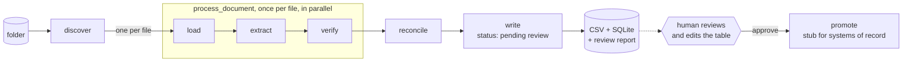
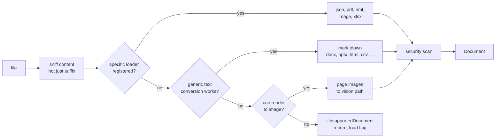
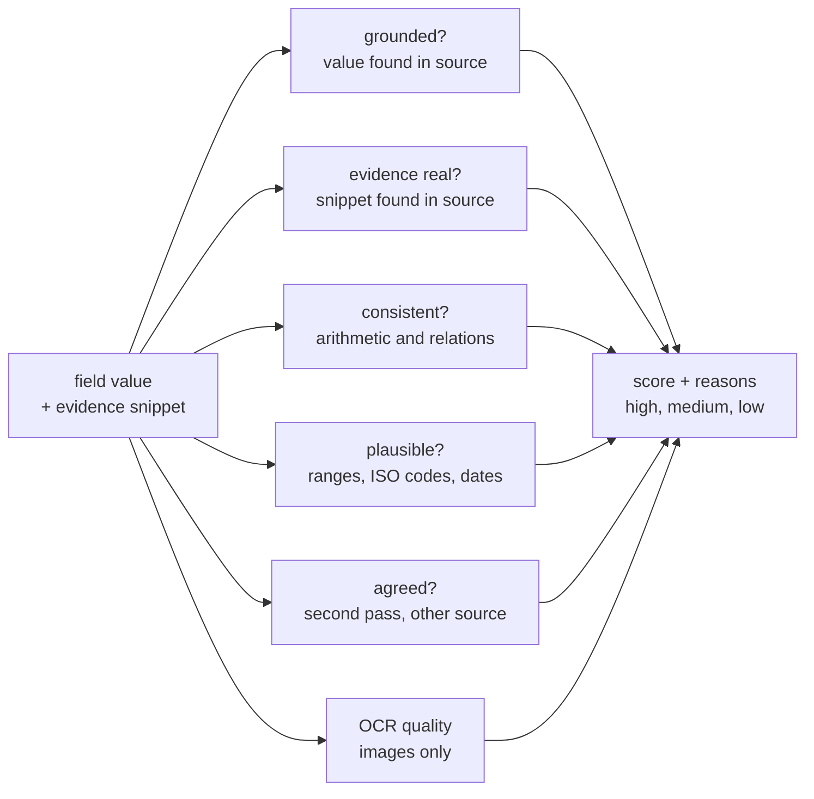
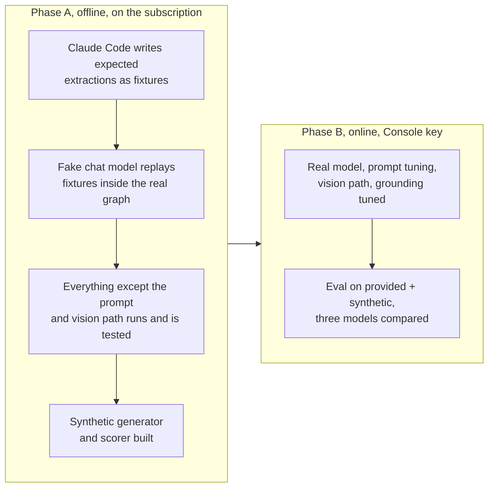

# Plan: Document Intelligence Agent

Take-home for Axmed ([brief](docs/brief.md)). Ingest a folder of mixed supplier documents, extract quotation lines into one schema, write a reviewable table, and flag uncertainty. Built to survive the next document, not just these eight.

Status: planning, revision 2. Decisions and who made them are in [docs/agent-log.md](docs/agent-log.md).

## The one idea

Every input becomes the same neutral `Document` (text, optional page images, metadata, security flags). One schema-driven extraction runs over all of them. Format knowledge lives only in loaders. Supplier knowledge lives nowhere. Confidence is computed by code from evidence, not reported by the model.



The table is the review surface, as the brief says. The pipeline writes it and stops. A person reviews and edits it. The `promote` step is the LangGraph interrupt: it resumes only on approval and is a stub here, because what happens after approval is Axmed's systems, not this task.

| Layer | What it is | Why |
|---|---|---|
| Loaders, verify, reconcile, writer, security | Plain Python | Quality lives here. No framework between us and the documents. |
| Graph, fan-out, retries, checkpoint, approval stop | LangGraph | Orchestration, resume after crash, human-in-the-loop as a primitive. |
| Model calls, structured output, provider swap | LangChain | One call shape for text and image inputs, any provider behind a config string. |
| Tracing, eval dataset | LangSmith | Every call recorded with inputs, outputs, tokens, cost. One env var. |

## Code layout

Standard src layout, installable package, one subpackage per concern.

```
pyproject.toml           uv-managed, pinned lockfile
src/docintel/
  config.py              model string, paths, concurrency, thresholds, weights
  documents.py           Document, Evidence, SecurityFlag
  ingest/
    sniff.py             content-based type detection, suffix as fallback
    registry.py          {media type -> loader}, fallback chain, UnsupportedDocument
    json_loader.py  pdf_loader.py  eml_loader.py  image_loader.py  xlsx_loader.py
    generic_loader.py    markitdown fallback for anything else with text
    security.py          hidden text, unicode tricks, injection patterns
  extract/
    schema.py            Pydantic: ExtractionResult, QuotationLine, Evidence
    prompt.py            system prompt, untrusted-data framing
    extractor.py         with_structured_output, text or image messages
  verify/
    grounding.py         is each value present in the source
    checks.py            arithmetic, derivation, plausibility, currency
    confidence.py        composite score and reasons
  reconcile.py           group same product across sources, conflicts
  store/
    writer.py            CSV, SQLite, review_report.md
  graph.py               StateGraph, Send fan-out, checkpointer, interrupt
  cli.py                 run, approve, draw, eval
tests/                   offline by default, fixtures replayed by a fake model
evals/                   synthetic generator, public-sample fetcher, scorer
data/
  provided/              the eight files from Axmed (committed)
  synthetic/             generated, with ground truth (committed, small)
  public/                downloaded samples (git-ignored)
output/                  records.csv, review.sqlite, review_report.md
docs/                    brief, plan, agent log, write-up
```

## Target schema

Extended from the suggested five fields. One row per quotation line. Every field in the Price group is present in at least one of the provided documents, and each changes whether two prices are comparable.

| Group | Fields |
|---|---|
| Provenance | source_document, source_locator (page, line, JSON path), supplier_name, quotation_ref, document_date, valid_until |
| Product | product_name, inn, strength, dosage_form, uom, units_per_pack |
| Price | price_per_pack, price_per_uom, currency, price_basis (stated, derived, list, net, tiered), discount_pct, price_tiers, incoterm, moq, lead_time_days |
| Corrections | superseded (field, old value, new value, reason) |
| Review | per-field confidence and reasons, overall_confidence, needs_review, status (pending, approved, rejected) |

Field glossary, since several are trade terms:

| Field | Meaning | Why it matters |
|---|---|---|
| inn | International Nonproprietary Name, the generic drug name. Paracetamol, not Panadel. | The only key that matches products across suppliers. |
| uom | Unit of measure the price refers to: tablet, vial, ampoule, bottle, pen. | A price per tablet and a price per bottle are not comparable. |
| units_per_pack | How many UOM in the pack the supplier sells. | Converts pack price to unit price. |
| incoterm | Trade term saying who pays freight and insurance and where risk passes. EXW, FCA, FOB, CIF, CIP. | A CIF price includes shipping, an EXW price does not. Same number, different cost. |
| moq | Minimum order quantity. | Whether the price is even available at Axmed's volume. |
| discount_pct | Discount shown on the quotation line. | List price versus net price. The Andina PDF has this column. |
| price_tiers | Volume tiers when a single price is not given. | Ubuntu Health quotes three tiers. |

Separate tables: `flags` (one row per concern, linked to a record) and `conflicts` (one row per product that appears from more than one source with disagreeing values).

## Loading: built for the file type we have not seen



- Type is sniffed from content, so a misnamed `.txt` that is really JSON still loads.
- A specific loader exists where quality needs it. Everything else falls through a generic converter, then a render-to-image path, then a loud unsupported record. Nothing is silently skipped.
- Adding a format with special needs is one file and one registry line. A contract test runs over every registered loader and every sample file.
- `xlsx_loader.py` is the demonstrated extension: the generic path already handles Excel, the specific loader adds sheet and header awareness. A `.docx` dropped in the folder is the demonstration that the fallback works with zero code.

## Confidence is computed, not asked for

Models are poor at estimating their own confidence. The extractor is asked for evidence instead: for every field, the verbatim snippet it took the value from. Code then scores each field from independent signals.



| Signal | How | Applies to |
|---|---|---|
| Grounded | Normalised value searched in the source text or JSON tree. Fuzzy for OCR text. | All |
| Evidence real | The quoted snippet exists in the source and contains the value. | All |
| Consistent | Pack price equals unit price times units. Quantity times unit price less discount equals extended. Dates in order. | Where the inputs exist |
| Plausible | Price ranges per UOM, ISO 4217 currency, integer pack sizes, known incoterms. | All |
| Agreed | Same value from a second extraction pass (optional, doubles cost), from a cross-document duplicate (the Andina scans versus the PDF), or from Tesseract OCR text. | Images, duplicates |
| OCR quality | Tesseract per-word confidence around the evidence region. | Images |

Score starts at 1.0 and each failed signal subtracts a configured weight. Tiers: high, medium, low. Low forces `needs_review`. Every subtraction is recorded as a reason the reviewer can read. Weights live in config and are tuned on the synthetic set, where ground truth is known. The model's own confidence, if given, is a tie-breaker at most. The write-up shows a calibration plot: do low-confidence fields actually turn out wrong more often.

## Prompt injection and hostile documents

Supplier documents are untrusted input to a model. Mitigations at four points:

| Point | Mitigation |
|---|---|
| Load | `security.py` flags hidden PDF text (white, tiny, off-page), zero-width and bidi characters, hidden HTML elements in email, and instruction-like phrases. Flags travel with the Document. |
| Prompt | All instructions in the system prompt. Document content inside explicit delimiters, framed as untrusted data whose instructions must be ignored. Structured output only, no tools, no network. An injection can at worst corrupt fields, never act. |
| Output | Schema validation, string sanitisation (no URLs or control characters, length caps), and grounding. A fabricated value has no evidence. |
| Pipeline | Any security flag forces `needs_review`. Nothing reaches `promote` without a person. Flags appear in the review report and the trace. |

A hostile fixture in the synthetic set (JSON with an embedded instruction, PDF with white text) asserts the flags fire and the values stay grounded.

## Data and evaluation

Eight files is not an evaluation. Two additions, both part of Phase A.

**Synthetic by construction.** `evals/synth/` generates ground truth first (a pharma vocabulary of INNs, strengths, forms, suppliers, currencies, incoterms), then renders each truth into every format: JSON in several unrelated shapes (nested, flat, camelCase, pack price only, tiered), PDF in several ReportLab layouts, email with and without a later correction, and images degraded with rotation, blur, noise, glare and cropping. Because the truth is known exactly, the scorer measures field-level precision and recall, numeric tolerance, and confidence calibration. This is the same method Axmed used to make the pack.

**Public samples for robustness.** A fetch script downloads a handful of real price lists and catalogues (UNICEF Supply Division, Global Fund pooled procurement reference prices, MSH price guide, IDA Foundation). No ground truth, so these are smoke tests: does the pipeline degrade into flags rather than crash or guess. Git-ignored, documented.

**Model comparison.** The same eval runs across Haiku 4.5, Sonnet 5.5 and Opus 5.5 behind the one config string. The table goes in the write-up with cost per document.

## Engineering standard

- uv for environment and lockfile, exact pins.
- ruff for lint and format, mypy on `src/`, pytest offline by default, pre-commit.
- GitHub Actions on every push: lint, type check, offline tests, eval scorer on fixtures.
- Structured logging, `.env.example`, no secrets in git.
- README visual: Mermaid architecture printed from the graph, calibration plot, review report screenshot.

## Model

Default `anthropic:claude-sonnet-5-5` for text and images through one config string. The latest Haiku is 4.5, there is no Haiku 5.5. Compared against Haiku 4.5 and Opus 5.5 in the eval.

## Development strategy



## Build sequence

Priority order. A cut at any line still leaves a complete, honest submission.

```mermaid
gantt
  title Build sequence, realistic estimate 9 to 10 hours of commits
  dateFormat HH:mm
  axisFormat %H:%M
  section Core
  Scaffold, uv, ruff, mypy, CI, CLAUDE.md         :s1, 00:00, 30m
  Document model, sniff, registry, fallback chain :i1, after s1, 40m
  Specific loaders and security scan              :i2, after i1, 60m
  Schema, prompt, fixtures, fake model            :e1, after i2, 60m
  Extract node and grounding                      :e2, after e1, 45m
  Checks, confidence, reasons                     :v1, after e2, 45m
  Reconcile, writer, review report                :w1, after v1, 45m
  Graph, fan-out, checkpoint, approve stop, CLI   :g1, after w1, 45m
  section Prove
  Synthetic generator and scorer                  :p1, after g1, 75m
  Live runs, prompt tuning, model comparison      :p2, after p1, 60m
  Hostile fixtures and docx fallback demo         :p3, after p2, 20m
  section Deliver
  Write-up, agent log, README visuals             :d1, after p3, 60m
  section Stretch
  MCP server over the review table                :x1, after d1, 30m
```



The brief's box is 4 to 6 hours. This plan is nearer 10. Real time spent is stated in the write-up.

## Deliverables

- [ ] Private repo shared with @malber, @albertovpd, @cesar-axmed, granular history, visual README with run instructions
- [ ] Output table with confidence, reasons and source references
- [ ] Agent-generated conversation summary, [docs/agent-log.md](docs/agent-log.md)
- [ ] One-page write-up covering the nine required sections
- [ ] Video walkthrough under five minutes

## Assumptions to state

- `price_per_uom` is the list unit price in the document's currency. Net after discount is a separate field. No FX conversion, cross-currency conflicts are flagged as not directly comparable.
- Tiered price lists produce one row at the lowest-quantity tier, with all tiers in `price_tiers` and a flag.
- A document that corrects itself later wins with the later value, and both are kept.
- Scans of a document also present as a PDF are extracted independently, then cross-checked, because in production the PDF will not always be there.

## Risks

- LangGraph and LangChain version churn. Exact pins, day one.
- Vision extraction on the glared scan will be poor. It must degrade into low confidence and flags, not guesses.
- Scope. The standard is high and the list is long. The sequence above is the cut order.
