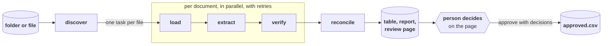
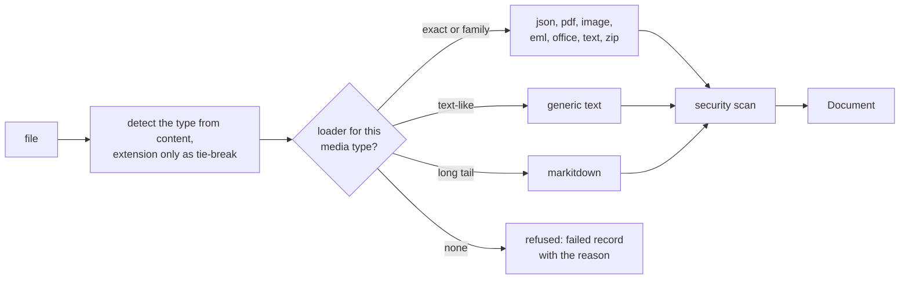
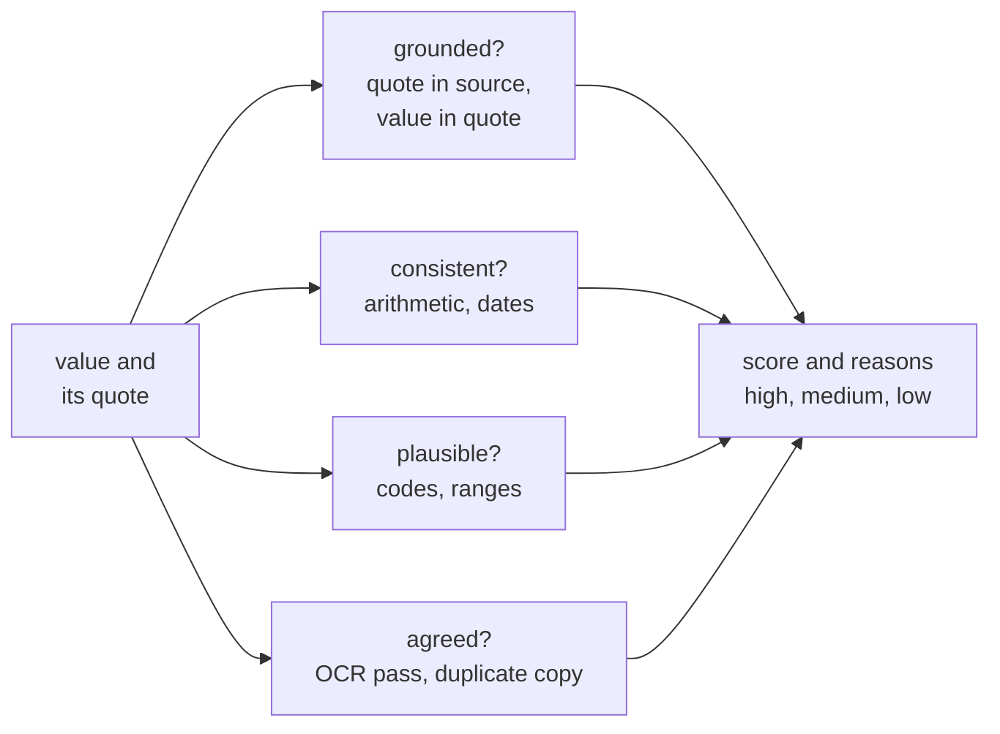

# Design

Take-home for Axmed ([brief](docs/brief.md)): ingest a folder of mixed supplier documents, extract quotation lines into one schema, write a reviewable table, flag uncertainty. Built to survive the next document, not just these eight.

This is the design as built. What a user sees is in [docs/walkthrough.md](docs/walkthrough.md), the mechanism in [docs/how-it-works.md](docs/how-it-works.md), and every decision with who made it in [docs/agent-log.md](docs/agent-log.md). What was planned and not built is listed at the end.

## The one idea

Every input becomes the same neutral `Document` (text, optional page images, metadata, flags, children). One schema-driven extraction runs over all of them. Format knowledge lives only in loaders. Supplier knowledge lives nowhere. Confidence is computed by code from evidence, never reported by the model.

| Layer | What it is | Why |
|---|---|---|
| Loaders, security scan, verify, reconcile, writer, page | Plain Python | Quality lives here. No framework between us and the documents. |
| Graph, fan-out, retries, checkpoint, review stop | LangGraph | Orchestration, resume after a crash, human-in-the-loop as a primitive. |
| Model calls, structured output, provider swap | LangChain | One call shape for text and image inputs, any provider behind a config string. |
| Tracing | LangSmith, optional | Every call recorded. One environment variable. |

## Target schema

One row per quotation line. Every field in the Price group appears in at least one provided document, and each changes whether two prices are comparable.

| Group | Fields |
|---|---|
| Provenance | source_document, source_path, source_locator (page, line, item), parent_document, supplier_name, quotation_ref, document_date, valid_until |
| Product | product_name, inn, strength, dosage_form, uom, units_per_pack |
| Price | price_per_pack, price_per_uom, currency, price_basis (stated, derived, list, tiered, unknown), discount_pct, price_tiers, quantity, extended_amount, incoterm, moq_packs, lead_time_days |
| Corrections | superseded (field, old, new, reason) |
| Review | evidence per field, confidence per field with reasons, overall_confidence, needs_review, review_reasons, flags, status |

| Field | Meaning | Why it matters |
|---|---|---|
| inn | International Nonproprietary Name, the generic drug name. Paracetamol, not Panadel. | The only key that matches products across suppliers. |
| uom | Unit of measure the price refers to: tablet, vial, ampoule, bottle, pen. | A price per tablet and a price per bottle are not comparable. |
| units_per_pack | How many UOM in the pack the supplier sells. | Converts pack price to unit price. |
| incoterm | Who pays freight and insurance and where risk passes: EXW, FCA, FOB, CIF, CIP. | A CIF price includes shipping, an EXW price does not. |
| moq_packs | Minimum order quantity, in packs. | Whether the price is available at the buyer's volume. |
| price_tiers | Volume tiers when a single price is not given. | The row carries the lowest tier and is flagged. |

## Loading: built for the file type we have not seen

| Tier | Formats | How |
|---|---|---|
| Specific loader | JSON in any shape; PDF with a text layer, without one, or with a garbled scanner layer; PNG, JPEG, TIFF and other images; EML with plain, HTML and attachments; XLSX, DOCX; CSV in any dialect; plain text, XML, HTML, Markdown, chat exports | One module each. The PDF loader decides by structure whether a page is a scan and measures text-layer quality, so garbage layers go to the vision path. |
| Generic | PPTX, RTF, legacy Office and whatever markitdown can convert | No code per format. |
| Containers | ZIP, email with attachments | Expanded into members, each its own Document with a parent reference. Attachment bytes are kept so pages can be previewed. |
| Refused with a reason | Encrypted PDFs, empty files, unknown binaries, oversized files | A failed record carrying the reason. Never a crash, never a guess. |

Malformed files degrade in steps and say so: strict JSON, then lenient, then as text; a truncated PDF yields the pages it still has. Caps on size, pages and attachments are flagged when hit. The synthetic set carries one case of each: empty, truncated, encrypted, broken JSON, misnamed, random bytes.

## Extraction

The model fills one Pydantic schema per document through LangChain structured output, with retries. It must quote, verbatim, the text each value came from; it may mark a value illegible; it may report a correction found later in the document. It is never asked for a confidence. The prompt names no supplier, layout, dialect or field name from any file we hold, and frames the document as untrusted data inside delimiters.

Offline, a `FixtureExtractor` replays a recorded extraction keyed by document id or file stem, so everything downstream is exercised without a key. A recording that does not fit the schema, or a backend that gives up after its retries, becomes that document's flagged empty record rather than a crashed batch.

### Vision path

Images, image-only PDFs and PDFs whose text layer fails the quality gate take one route: the page is transcribed to text (by a vision model, or by the OCR engine offline), the same extraction prompt runs over the transcript, and an independent OCR pass over the same page gives the verifier a second reading with per-line confidence. Transcribing first keeps one extraction path for every format and leaves an inspectable artefact a reviewer can read.

### OCR engine, measured

On our degraded synthetic scans and the two provided scans, where the printed prices are known:

| Engine | Price recall | Name recall | Line confidence, legible pages | Line confidence, unreadable pages |
|---|---|---|---|---|
| RapidOCR (PP-OCRv6, ONNX Runtime) | 0.44 | 0.54 | 0.96 to 0.99 | 0.58 and 0.64 |
| Tesseract 5 | 0.10 | 0.27 | 0.3 to 0.9, erratic | 0.16 to 0.33 |

RapidOCR's medium and server model variants score the same recall at 20 to 70 times the time per page; image quality is the limit, not model size. Decision: RapidOCR behind an `OcrEngine` interface, Tesseract as the fallback when installed. Its line confidence separates readable from unreadable pages, which is the property the agreement signal needs.

## Confidence is computed, not asked for

| Signal | How | Applies to |
|---|---|---|
| Grounded | Normalised value found in the source text; the quoted evidence found in the source and containing the value. Numbers match across formats; INNs match on components, so TDF/3TC/DTG matches the full names. | All |
| Consistent | Pack price equals unit price times units; quantity times unit price less discount equals the extended amount; dates in order; validity against the as-of date. | Where the inputs exist |
| Plausible | ISO 4217 currency, known incoterms, integer pack sizes, price ranges per unit. | All |
| Agreed | The value is present in the independent OCR reading of the page; the value agrees with another copy of the same quotation. | Scans, duplicates |

Each field starts at 1.0 and loses a configured weight per failed signal; every deduction is recorded as a reason. Tiers are high, medium, low. A derived unit price inherits the weaker of its inputs. The overall score is the minimum over key fields, where a missing essential field (product, INN, unit price, currency) counts as zero. Any key field below the bar, any security flag, or any correction or tier the reviewer should see sets `needs_review` with the reasons spelled out. Weights live in config and were tuned on the main synthetic set only.

## Prompt injection and hostile documents

| Point | Mitigation |
|---|---|
| Load | Hidden PDF text (tiny, off-page, white on white), hidden HTML elements, zero-width and bidirectional characters, instruction-like phrases. Flags travel with the Document. |
| Prompt | All instructions in the system prompt; the document inside delimiters as untrusted data. Structured output only, no tools, no network: an injection can at worst corrupt fields, never act. |
| Output | Schema validation and grounding. A fabricated value has no evidence. |
| Pipeline | Any security flag forces review. Nothing reaches `approved.csv` without a person. |

Four hostile synthetic cases assert the flags fire and the values stay grounded; none of the clean cases or the provided files trigger them.

## Reconcile

Lines are matched across documents on normalised INN, strength and form. Products quoted by more than one supplier appear as conflicts with unit prices side by side and a note on comparability (same currency and unit, or not; no FX is applied). A quotation that arrived as several files (the Andina PDF and its two scans) is cross-checked field by field: agreeing values lift each other's confidence and clear the stale review reason; disagreeing ones are flagged.

## Review and approve

The run writes `records.csv`, `review.sqlite`, `review_report.md`, `conflicts.json` and `review.html`, then stops at a LangGraph interrupt. The page is one self-contained file: one row per line, least certain first, the source beside the fields, decisions kept in the browser and exported as JSON. `approve` resumes the same thread, applies the decisions, writes `approved.csv` and `decisions_applied.json`. What happens after approval is the buyer's systems, not this task.

## Data and evaluation

**Synthetic by construction.** `evals/synth/` generates ground truth first from a pharma vocabulary, then renders each truth into every format: JSON in several unrelated shapes including French keys, three PDF layouts, scanned PDFs with and without a garbage OCR layer, faxes, photos, glare, rotation and crops, four email styles, chat exports, Excel, Word, CSV dialects, XML, HTML, plain text, hostile carriers, misnamed and malformed files. 66 cases, deterministic, verified by CI against the committed set.

**Passing is behaving as expected.** Every case carries an `expect`: extract everything exactly; extract and flag; degrade honestly with no invented lines and no wrong value at high confidence; refuse with a reason. Calibration (wrong at high confidence) is measured across all cases.

**Generalisation discipline.** A held-out set from a different seed is built on demand and never opened while tuning. The prompt names nothing from any file we hold. 37 public price lists and RFQ forms, with no truth, are robustness tests only; only open-licensed ones are committed and every source's licence is recorded.

**Live, Sonnet 5.5.** The first live run on the synthetic set passed 55 of 66 with 10 wrong values at high confidence, every one on a scan: on the vision path the model's values were grounded against the model's own transcript. Names, INN and strength are now checked against the independent OCR reading like prices, pack prices are derived when only a unit price is printed, a concentration written into the INN moves to the strength, empty lines are dropped, and the output cap allows a 40-line price list. The same recorded extractions through the fixed pipeline pass 65 of 66 with no invented lines; the two remaining wrong values at high confidence are one cropped photo where the model and the OCR read the same wrong digit, which no second reading can catch. Eight wrong values are at medium or low confidence, which is review work the page surfaces. Every live extraction and transcript is recorded under `tests/fixtures/live/sonnet-5-5` and replays for free. Reports in `evals/reports`.

**Held-out, live.** Sonnet 5.5 on the held-out seed, never opened while tuning: 63 of 66, recall 0.97, no silent errors beyond the same cropped-photo digit. Against 65 of 66 on the main set, that is the generalisation result. Haiku 4.5: 58 of 66 on the main set and 52 of 66 held-out, with 10 and 25 wrong values at high confidence, mostly on scans and on one text document where it folded the dosage form into the strength; it is about a quarter of Sonnet's cost per document (evals/reports/cost.md, prices assumed). Its two failure modes drove two general repairs: a quote sent as a number is kept as text, and a form written into the strength moves to the form field.

**Provided pack.** Hand-written expected extractions for the eight files, with the scans marking illegible fields honestly. Three further sets were written blind by Haiku 4.5, Sonnet 5.5 and Opus 5.5 working the same documents; Sonnet and Opus pass every covered case, and their agreement against the answer key found three defects in the truth, which were corrected. Reports are in `evals/reports`.

**Backlog of expected-outcome cases.** An RFQ with no prices, a purchase order and an invoice that look like quotations, two quotations in one PDF, per-100 pricing, two currencies in one document, a bid tabulation with several suppliers, a spreadsheet with uncached formulas, a password-protected archive member, handwritten corrections.

**Review page backlog.** Outline on the scan the exact spot a price was read from, using the OCR engine's word boxes; decide-and-advance with undo; approve a document's clean lines in one action; a header row per document when sorted by document.

## Deployment and data residency

The build uses cloud models. A medical deployment may be bound by patient confidentiality and client contracts to keep every byte inside the organisation's environment: open-weight models on infrastructure it controls (its own cloud account, GPU capacity sized for the volume), or the cloud provider's inference service under a data-processing agreement. The pipeline is built for that swap: the model is a `provider:model` string behind one interface, the OCR pass is already local, and the eval set is how a candidate earns the slot. What would need work: a local vision model for the scan path, where the larger Qwen VL models are the first candidates because of their OCR-grade reading, and structured-output quality on open models, which varies.

## Engineering standard

uv with a locked environment; ruff for lint and format; mypy strict on `src/`; 411 offline tests on recorded fixtures; GitHub Actions on every push running lint, types, a rebuild of the synthetic set compared against the commit, and the tests. A Playwright script drives every control on the review page. Trunk with small commits, each explaining why; never squashed.

## Assumptions

- `price_per_uom` is the stated unit price in the document's currency; a unit price derived from a pack price is marked derived and reviewed. No FX conversion.
- Tiered price lists produce one row at the lowest-quantity tier, with all tiers kept and a flag.
- A document that corrects itself later wins with the later value, and both are kept.
- Scans of a document also present as a PDF are extracted independently, then cross-checked, because in production the PDF will not always be there.

## Known limits

- **Handwriting.** The brief names scans and photos, not handwriting, and quotations rarely carry much of it. Where it appears (a corrected price in pen, a signed note), a strong vision model will read legible handwriting but the OCR engine will not, so the agreement signal would deduct from values the model read correctly and over-flag the page. Seán's observation from earlier work on documents with handwriting. The mitigation path is known: detect handwritten regions, or treat low OCR line confidence over a region as "no second reading" rather than disagreement, and use a second vision pass as the agreement signal there.
- **Two readers, one wrong digit.** When the vision model and the OCR engine read the same wrong value, as on the cropped photo, nothing in the pipeline can know. The arithmetic check catches it only when the extended amount is also on the page. A third reading from a different model family is the mitigation, and it costs a call.
- **Phone photo formats.** HEIC and other formats Pillow does not open become refused records with the reason, not page images.
- **Outlook `.msg`, OpenDocument, archives other than ZIP.** No loader; refused with the reason. Each is one loader if needed.

## Planned, not built, and why

- **Render-to-image fallback for unknown formats.** Everything the spec names has a loader or converts through markitdown; a LibreOffice dependency was not worth it for the long tail.
- **Second extraction pass from a different model family on low-confidence prices.** The setting exists; the pass does not. It cannot be verified without live calls, and whether it earns its cost (one extra call per flagged page) is a question the first live run's calibration answers. Until then the OCR agreement signal covers the scan case it was meant for.
- **Calibration plot** in the write-up. The scorer measures wrong-at-high-confidence; the plot waits for live runs.
- **Model comparison with cost per document.** Blocked on the same key. The blind agent sets are the interim comparison. In practice the comparison would cover the other closed-source families too (OpenAI, Google), not only Claude's, since the provider is a config string (Seán's note for the write-up).
- **MCP server over the review table.** A stretch item; the page and the SQLite file cover the need.
