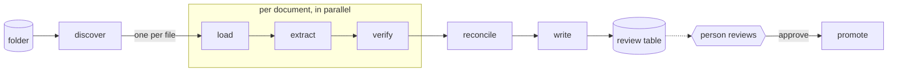

# docintel

Document intelligence pipeline for supplier quotations. Takes a folder of mixed documents (JSON exports, PDFs, emails, scanned images, and whatever arrives next), extracts quotation lines into one schema, writes a table a person can review, and says exactly which values it is unsure of and why.

Built for the Axmed AI Engineer take-home. The [brief](docs/brief.md), the [plan](PLAN.md) and the [agent log](docs/agent-log.md) record what was asked, what was decided, and who decided it.



## Status

Planning complete, build starting. See [PLAN.md](PLAN.md) for the architecture, the extension points, how confidence is computed, and the build sequence.

## Layout

```
data/provided/    the eight documents supplied with the brief
data/synthetic/   generated documents with known ground truth
evals/            synthetic generator, public sample fetcher, scorer
src/docintel/     the pipeline
docs/             brief, agent log, write-up
```

## Running

Setup and run instructions follow once the pipeline exists.
