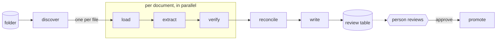

# docintel

[](https://github.com/sean-carmody5/axmed-docintel/actions/workflows/ci.yml)

Document intelligence pipeline for supplier quotations. Takes a folder of mixed documents (JSON exports, PDFs, emails, scanned images, and whatever arrives next), extracts quotation lines into one schema, writes a table a person can review, and says exactly which values it is unsure of and why.

Built for the Axmed AI Engineer take-home. The [brief](docs/brief.md), the [plan](PLAN.md) and the [agent log](docs/agent-log.md) record what was asked, what was decided, and who decided it.



## Status

Evaluation data in place, pipeline build starting. See [PLAN.md](PLAN.md) for the architecture, the extension points, how confidence is computed, and the build sequence.

## Data

| Set | Where | What | Ground truth |
|---|---|---|---|
| Provided | `data/provided/` | The eight documents supplied with the brief | Hand-checked fixtures |
| Synthetic | `data/synthetic/` | 59 generated cases: JSON in seven dialects including French keys, three PDF layouts, scanned PDFs with and without a garbage OCR layer, faxes and photos, four email styles, WhatsApp exports, Excel, Word, CSV, XML, HTML, plain text, hostile carriers, misnamed and malformed files ([README](data/synthetic/README.md)) | Exact, by construction |
| Public | `data/public/` | 37 real price lists, catalogues and RFQ forms from UNICEF, Global Fund, PAHO, WHO, national procurement bodies and a manufacturer. Six open-licensed files are committed, the rest are fetched by `evals/public/fetch.py` ([README](data/public/README.md) lists all with licences) | None, robustness only |

## Layout

```
data/provided/    the eight documents supplied with the brief
data/synthetic/   generated documents with known ground truth
data/public/      downloaded real documents, git-ignored
evals/synth/      synthetic generator
evals/public/     public sample sources and fetcher
src/docintel/     the pipeline
docs/             brief, agent log, write-up
```

## Running

```
uv sync --all-groups
uv run docintel run data/provided --out output/provided        # offline: replays recorded extractions
uv run docintel run data/provided/some_quotation.pdf --out output/one   # a single file works too
uv run docintel approve --thread-id <id> --out output/provided --decisions decisions.json
uv run docintel draw                                           # the graph as Mermaid
```

`review.html` in the output folder is the review page: one row per quotation line with the product, the price and one short note saying what needs a person, least certain first. Open a row for the fields, the reasons and the evidence quotes; approve, hold or reject (`a`/`h`/`r`, `j`/`k` to move), then "Export decisions" and pass the JSON to `approve --decisions`. One file, no server, opens from disk.

Live extraction needs an API key and the model backend:

```
export ANTHROPIC_API_KEY=...
uv run docintel run data/provided --out output/provided --extractor model --model anthropic:claude-sonnet-5-5
```

Set `LANGSMITH_TRACING=true` and `LANGSMITH_API_KEY` to trace every call. Outputs are `records.csv`, `review.sqlite`, `review_report.md`, `review.html` and `conflicts.json` in the output folder. The run stops after writing them; `approve` resumes it.
