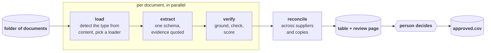
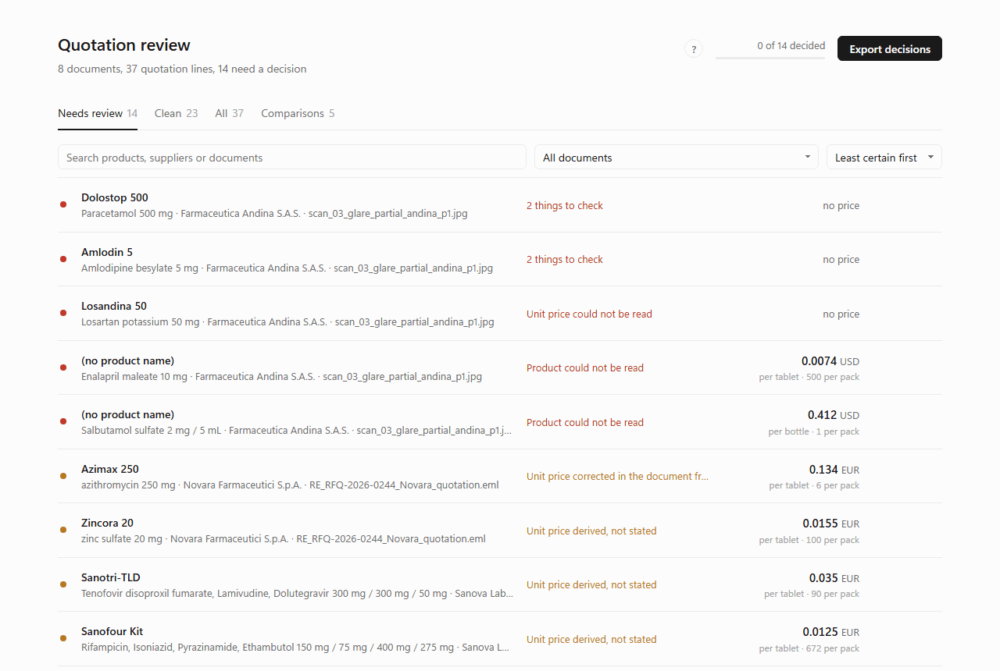
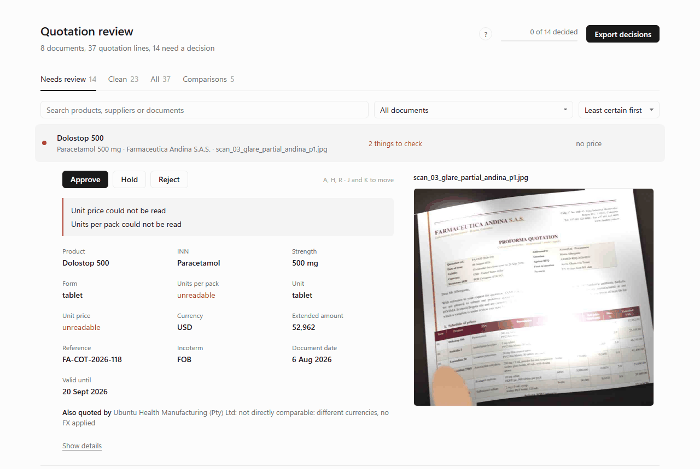
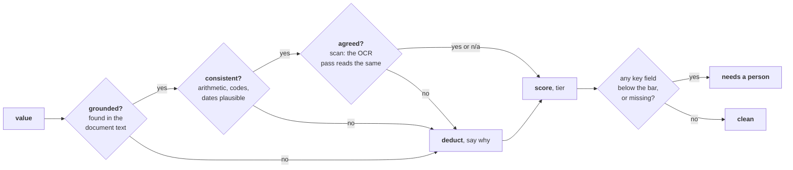

# docintel

[](https://github.com/sean-carmody5/axmed-docintel/actions/workflows/ci.yml)

Supplier quotations arrive as PDFs, scans, emails, spreadsheets and JSON exports. docintel reads a folder of them, pulls every quotation line into one table, works out how sure it is of each value and why, and gives a person a page to approve, hold or reject each line with the source document beside it.



## Try it

### Mock run, no key

Replays recorded extractions through the real pipeline. Every loader, check, score, the reconciliation and the page are real; only the model call is replayed.

```
uv sync --all-groups
uv run docintel run data/provided --out output/demo --as-of 2026-08-20 --review
```

The run stops at the review step and opens the page in your browser. Decide, correct anything you can read in the source that the pipeline could not, press **Apply decisions**: approve runs and `approved.csv` holds the lines that go on. Without `--review` the page still opens from disk; there the button saves `decisions.json` for `docintel approve`, or serve it later with `docintel review --out output/demo`. The full session, with what each step prints, is in [docs/walkthrough.md](docs/walkthrough.md).

### Live run, with a model

```
cp .env.example .env                       # put ANTHROPIC_API_KEY in it
uv run --env-file .env docintel run data/provided --out output/live --as-of 2026-08-20 --extractor model --model anthropic:claude-sonnet-5-5
```

Add `--review` to finish on the page, exactly as above; applying decisions needs no model call. Every live extraction and page transcript is recorded under `output/live/extractions`, and `--fixtures output/live/extractions` replays the run exactly, for free. The model reads text documents directly and transcribes scanned pages; the OCR cross-check stays local. `DOCINTEL_VISION_MODEL` in `.env` picks a different model for pages. Flags fall back to `DOCINTEL_*` variables in `.env`, so with `DOCINTEL_EXTRACTOR=model` set there the live command is the mock one. Any folder or single file works as input.

### Other providers

The model is a `provider:model` string resolved by LangChain. Install the provider's extra, put its key in `.env`, change the string:

| Provider | Install | Model string | Credentials |
|---|---|---|---|
| Anthropic | included | `anthropic:claude-sonnet-5-5` | `ANTHROPIC_API_KEY` |
| OpenAI | `uv sync --all-groups --extra openai` | `openai:<model>` | `OPENAI_API_KEY` |
| Google | `uv sync --all-groups --extra google` | `google_genai:<model>` | `GOOGLE_API_KEY` |
| AWS Bedrock | `uv sync --all-groups --extra aws` | `bedrock:<model id>` | AWS credentials and region |
| Ollama, local | `uv sync --all-groups --extra ollama` | `ollama:<model>` | none |

Only Anthropic has been exercised. The others resolve through the same LangChain interface and should work, but are untested here. Structured output needs tool calling or a JSON mode on the provider's side; small local models do not always fill the schema reliably, which is what the synthetic set is for.

## The review page



One row per quotation line, least certain first. A red mark means something needed to price the line could not be read; amber means the values are there but one was reached in a way worth a look; no mark means every key value is in the document word for word. Open a row and the document sits beside the fields: the page image for scans and PDFs, zoomable, or the text with the evidence highlighted.



Click any value to correct it from the source; the correction travels with the decisions and `approve` keeps both values in the audit. Keys: `J` `K` move, `A` `H` `R` decide, `Esc` closes. The `?` explains the rest.

## What comes out

| File | What it is |
|---|---|
| `review.html` | The page above. One file, opens from disk, no server. |
| `records.csv` | Every line with its values, evidence quotes, per-field confidence and flags. |
| `review_report.md` | The same, as a report that leads with what to look at first. |
| `conflicts.json` | Products quoted by more than one supplier, and duplicate copies of a quotation cross-checked. |
| `review.sqlite` | Records, conflicts and duplicates, queryable. |
| `approved.csv`, `final.csv`, `decisions_applied.json` | After `approve`: the lines that go on; every line with its final status (rejected lines stay here, held ones stay pending); every decision and correction. |

## How it knows what it is unsure of

Confidence is computed, never asked of the model. Every value is tested against the document and the deductions are recorded, so the page can say why.



Rules a reviewer can rely on: a value that is not in the document is never confident; a unit price worked out from a pack price inherits the weaker of its inputs; a document that corrects itself later wins with the later value and keeps both; text addressed to an automated reader is flagged and ignored.

## New file types

Loaders are chosen by what the file contains, not what it is called. A new format is one loader; nothing downstream changes. Without a specific loader, text-like formats go through a generic text reader, Office and the long tail through markitdown, and anything else is refused with a reason rather than guessed at. Emails and archives open their attachments as documents of their own. The plan has the [full table](PLAN.md#loading-built-for-the-file-type-we-have-not-seen).

## Evaluation

| Set | Documents | Truth | Result |
|---|---|---|---|
| Provided pack | 8 | Hand-written expected extractions | 37 lines, 14 flagged for a person, 5 of them unreadable on the glare photo |
| Synthetic | 66 cases in 15 kinds, generated from truth | Exact | Fixture replay 66 of 66; Sonnet 5.5 and Opus 5.5 reading blind, 24 of 24 covered cases each, no invented lines |
| Synthetic, live | The same 66 cases through Sonnet 5.5 | Exact | First run 55 of 66, with 10 wrong values at high confidence, all on scans. The same recorded extractions through the fixed pipeline: 65 of 66, no invented lines, 2 wrong at high confidence (one cropped photo where the model and the OCR read the same wrong digit), 8 wrong values flagged for a person |
| Provided pack, live | 8 documents through Sonnet 5.5 | Hand-written fixtures | 37 lines in 76 s; key values agree with the fixtures except where the model was more careful than the fixture writer |
| Held-out synthetic, live | Same generator, different seed, never opened while tuning | Exact | Sonnet 5.5: 63 of 66, recall 0.97, 2 wrong at high confidence (the same cropped-photo digit). Haiku 4.5: 54 of 66, 14 wrong at high confidence |
| Model comparison | Synthetic set: Sonnet 5.5, Haiku 4.5, Opus 5.5 | Exact | Haiku 60 of 66, 4 wrong at high confidence, 12 invented lines, a quarter of Sonnet's cost. Opus 60 of 66, 5 wrong at high confidence (4 are a pack size written into the strength), nearly twice Sonnet's cost. About 2, 8 and 14 cents a document from recorded tokens with assumed prices ([evals/reports/cost.md](evals/reports/cost.md)) |
| Public | 37 real price lists and RFQ forms | None | Robustness only |

Cases are judged by the behaviour expected of them (extract, flag, degrade honestly, refuse), not by accuracy alone. CI replays the whole synthetic set through the pipeline and scores it on every push, alongside 411 offline tests. Details in [PLAN.md](PLAN.md#data-and-evaluation) and [evals/reports](evals/reports).

## Layout

```
src/docintel/      ingest/ extract/ verify/ reconcile.py store/ graph.py cli.py
data/              provided/ synthetic/ (truth included) public/ (fetched, licences listed)
evals/             synth/ generator, score.py, public/ fetcher, ui/ page check, reports/
tests/             offline, with recorded fixtures
docs/              brief, walkthrough, agent log, write-up
PLAN.md            the design as built, and what was planned but not
```

## Documents

- [docs/brief.md](docs/brief.md): the task as set.
- [docs/walkthrough.md](docs/walkthrough.md): a run from start to finish, as the user sees it.
- [docs/how-it-works.md](docs/how-it-works.md): the mechanism, stage by stage, in two pages.
- [PLAN.md](PLAN.md): the design and why.
- [docs/agent-log.md](docs/agent-log.md): what was decided, by whom, session by session.
