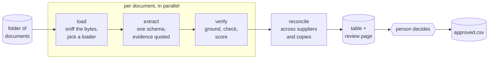
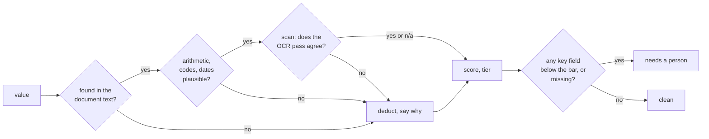

# docintel

[](https://github.com/sean-carmody5/axmed-docintel/actions/workflows/ci.yml)

Supplier quotations arrive as PDFs, scans, emails, spreadsheets and JSON exports. docintel reads a folder of them, pulls every quotation line into one table, works out how sure it is of each value and why, and gives a person a page to approve, hold or reject each line with the source document beside it.



## Try it

### Mock run, no key

Replays recorded extractions through the real pipeline. Every loader, check, score, the reconciliation and the page are real; only the model call is replayed.

```
uv sync --all-groups
uv run docintel run data/provided --out output/demo --as-of 2026-08-20
```

Then open `output/demo/review.html`, decide, press **Export decisions**, save the JSON as `output/demo/decisions.json`, and run the `approve` command the run printed. `approved.csv` holds the lines that go on. The full session, with what each step prints, is in [docs/walkthrough.md](docs/walkthrough.md).

### Live run, with a model

```
cp .env.example .env                       # put ANTHROPIC_API_KEY in it
uv run --env-file .env docintel run data/provided --out output/live --as-of 2026-08-20 --extractor model --model anthropic:claude-sonnet-5-5
```

Review and approve exactly as above; the approve command needs no key. The model reads text documents directly and transcribes scanned pages; the OCR cross-check stays local. `DOCINTEL_VISION_MODEL` in `.env` picks a different model for pages. Flags fall back to `DOCINTEL_*` variables in `.env`, so with `DOCINTEL_EXTRACTOR=model` set there the live command is the mock one. Any folder or single file works as input.

### Other providers

The model is a `provider:model` string resolved by LangChain. Install the provider's extra, put its key in `.env`, change the string:

| Provider | Install | Model string | Credentials |
|---|---|---|---|
| Anthropic | included | `anthropic:claude-sonnet-5-5` | `ANTHROPIC_API_KEY` |
| OpenAI | `uv sync --all-groups --extra openai` | `openai:<model>` | `OPENAI_API_KEY` |
| Google | `uv sync --all-groups --extra google` | `google_genai:<model>` | `GOOGLE_API_KEY` |
| AWS Bedrock | `uv sync --all-groups --extra aws` | `bedrock:<model id>` | AWS credentials and region |
| Ollama, local | `uv sync --all-groups --extra ollama` | `ollama:<model>` | none |

Structured output needs tool calling or a JSON mode on the provider's side; small local models do not always fill the schema reliably, which is what the synthetic set is for.

## The review page


One row per quotation line, least certain first. A red mark means something needed to price the line could not be read; amber means the values are there but one was reached in a way worth a look; no mark means every key value is in the document word for word. Open a row and the document sits beside the fields: the page image for scans and PDFs, zoomable, or the text with the evidence highlighted.


Keys: `J` `K` move, `A` `H` `R` decide, `Esc` closes. The `?` explains the rest.

## What comes out

| File | What it is |
|---|---|
| `review.html` | The page above. One file, opens from disk, no server. |
| `records.csv` | Every line with its values, evidence quotes, per-field confidence and flags. |
| `review_report.md` | The same, as a report that leads with what to look at first. |
| `conflicts.json` | Products quoted by more than one supplier, and duplicate copies of a quotation cross-checked. |
| `review.sqlite` | Records, conflicts and duplicates, queryable. |
| `approved.csv`, `decisions_applied.json` | After `approve`: the lines that go on, and every decision. |

## How it knows what it is unsure of

Confidence is computed, never asked of the model. Every value is tested against the document and the deductions are recorded, so the page can say why.



Rules a reviewer can rely on: a value that is not in the document is never confident; a unit price worked out from a pack price inherits the weaker of its inputs; a document that corrects itself later wins with the later value and keeps both; text addressed to an automated reader is flagged and ignored.

## New file types

Loaders are chosen by what the bytes are, not the file name. A new format is one loader; nothing downstream changes. Without a specific loader, text-like formats go through a generic text reader, Office and the long tail through markitdown, and anything else is refused with a reason rather than guessed at. Emails and archives open their attachments as documents of their own. The plan has the [full table](PLAN.md#loading-built-for-the-file-type-we-have-not-seen).

## Evaluation

| Set | Documents | Truth | Result |
|---|---|---|---|
| Provided pack | 8 | Hand-written expected extractions | 37 lines, 14 flagged for a person, 5 of them unreadable on the glare photo |
| Synthetic | 66 cases in 15 kinds, generated from truth | Exact | Fixture replay 66 of 66; Sonnet 5.5 and Opus 5.5 reading blind, 24 of 24 covered cases each, no invented lines |
| Held-out synthetic | Same generator, different seed | Exact | Never opened while tuning |
| Public | 37 real price lists and RFQ forms | None | Robustness only |

Cases are judged by the behaviour expected of them (extract, flag, degrade honestly, refuse), not by accuracy alone. Details in [PLAN.md](PLAN.md#data-and-evaluation) and [evals/reports](evals/reports).

## Layout

```
src/docintel/      ingest/ extract/ verify/ reconcile.py store/ graph.py cli.py
data/              provided/ synthetic/ (truth included) public/ (fetched, licences listed)
evals/             synth/ generator, score.py, public/ fetcher, ui/ page check, reports/
tests/             offline, with recorded fixtures
docs/              brief, walkthrough, agent log, write-up
PLAN.md            design, extension points, build sequence
```

## Documents

- [docs/brief.md](docs/brief.md): the task as set.
- [docs/walkthrough.md](docs/walkthrough.md): a run from start to finish, as the user sees it.
- [docs/how-it-works.md](docs/how-it-works.md): the mechanism, stage by stage, in two pages.
- [PLAN.md](PLAN.md): the design and why.
- [docs/agent-log.md](docs/agent-log.md): what was decided, by whom, session by session.
