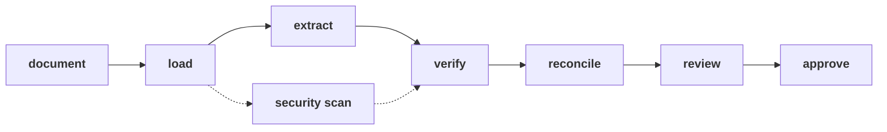
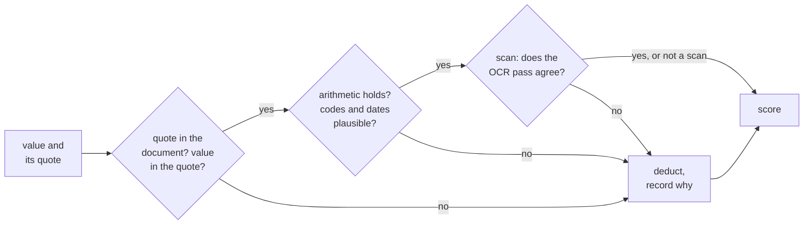

# How it works

The ins and outs, in the order a document goes through them. For what a user sees, read the [walkthrough](walkthrough.md); for why each choice was made, the [plan](../PLAN.md).

## 1. One shape for every format

Each file's type is detected from its content, not its name, and it is handed to a loader. Every loader produces the same neutral object: text, optional page images, metadata, flags, and children for anything nested (an email's attachments, a ZIP's members). From here on nothing knows or cares what the file was.

| Arrives as | Loader | Becomes |
|---|---|---|
| JSON in any shape | strict, then lenient, then as text | text (the JSON itself) |
| PDF with a real text layer | pymupdf4llm | markdown with tables |
| PDF that is a scan, or whose text layer is garbage | page render | page images |
| PNG, JPEG, TIFF, photo of a page | image loader | page images |
| Email | eml loader | body text, each attachment a child document |
| Excel, Word, CSV, HTML, XML, chat export, plain text | specific or generic loader | text |
| ZIP | archive loader | each member a child document |
| Encrypted, empty, truncated, unknown bytes | refused | a failed record with the reason |

A new format is one loader. The loader is the only place format knowledge lives; the prompt never names a supplier, a layout or a field name from any file we hold.

## 2. The model does one job

The extractor asks a model to fill one schema: supplier, reference, dates, currency, terms, and one line per product with product name, INN, strength, form, pack, prices, quantity, minimum order, lead time. For every value it must quote the text it took it from. It may mark a value illegible and may report a correction it found later in the document. It is never asked how confident it is.

Page images go through the same schema after a transcription step, so scans and PDFs take the identical path. Offline, a recorded extraction is replayed instead of calling a model; everything after this point is the same either way.

The document is given to the model as untrusted data inside delimiters. Hidden text, invisible characters and sentences addressed to automated readers are detected before extraction and flagged, and a flagged document always goes to a person.

## 3. Confidence is computed

Each value starts at 1.0 and loses a weighted amount for every check it fails. The checks are independent of the model:

- **Grounding.** The quote is found in the document and the value is found in the quote, after normalising numbers, units and INN spellings.
- **Arithmetic.** Pack price equals unit price times units per pack; quantity times unit price less discount equals the extended amount; dates in order; validity against the as-of date.
- **Plausibility.** ISO currency codes, known incoterms, integer pack sizes, price ranges per unit.
- **OCR agreement.** For scans, an independent OCR engine (RapidOCR) reads the page; a number present in both the model's reading and the OCR text scores high, one present in only one scores low. OCR line confidence around the value feeds the score.
- **Duplicates.** Where the same quotation arrived twice, values that agree between copies lift each other; values that disagree are flagged.

Every deduction is recorded with a reason, which is what the review page shows. Three rules worth knowing: a unit price worked out from a pack price inherits the weaker of its inputs; a missing essential field (product, INN, unit price, currency) scores zero, not nothing; a document that corrects itself later wins with the later value and keeps both.

A line needs a person when any key field is below the bar or missing. On the page, red means the line cannot be priced as it stands, amber means the values are there but one was reached in a way worth a look, and no mark means every key value is in the document word for word.

## 4. Reconcile across documents

Lines from all documents are matched on normalised INN, strength and form. Where two suppliers quote the same product, the unit prices are set side by side with a note on comparability (same currency and unit, or not). Where one quotation arrived as several files, the copies are cross-checked field by field.

## 5. Review, then approve

The run writes the table, the report and the page, then stops. The reviewer decides each line on the page, corrects any value they can read in the source that the pipeline could not, and exports both. `approve` resumes the same run from its checkpoint, applies corrections first (the corrected field scores 1.0 with the reason "set by reviewer", and the original is kept beside it in the audit), then the decisions, writes `approved.csv` with the lines that go on, and records everything in `decisions_applied.json`. Nothing reaches a system of record without a person.

## Orchestration

LangGraph holds the graph: discover, fan out one task per document with retries, reconcile, write, stop for review, promote. State is checkpointed to SQLite so a run survives a crash and resumes under its thread id. LangChain makes the model calls; the model is a `provider:model` string, so Anthropic, Bedrock, Vertex or a self-hosted model is configuration.

## What is real and what is mocked

Real: every loader, the security scan, the OCR pass, every check and score, reconciliation, the page, the approve step, the tests and the evaluation. Mocked until a key is available: the model call itself, replayed from recorded extractions. Recorded sets exist from hand-written fixtures and from Haiku 4.5, Sonnet 5.5 and Opus 5.5 reading the documents independently.

## How it is tested

- 66 synthetic cases in 15 kinds, generated from exact truth, each judged by the behaviour expected of it: extract fully, extract and flag, degrade honestly, refuse with a reason.
- A held-out set from a different seed, never opened while tuning.
- 37 public documents with no truth, for robustness.
- The eight provided documents, with hand-written expected extractions.
- 62 test functions, 411 cases after parametrisation: unit tests for every module (loaders, security, extraction schema, normalisation, grounding, checks, confidence, reconciliation, writers) and end-to-end runs of the real graph on the provided pack, including the review stop, resuming with decisions, a single-file input and a malformed recording.
- CI on every push: lint, types, the synthetic set regenerated and compared with the commit, the tests, then the whole synthetic set through the pipeline and scored, and the provided pack run and resumed.
- A Playwright script that drives every control on the review page, run by hand before the page is shown to anyone.
