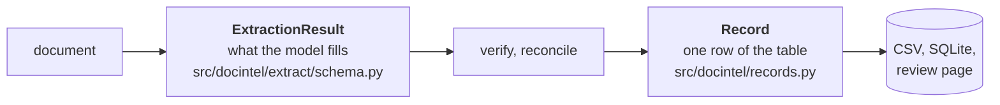

# The schema, and why it looks like this

The brief suggests five fields: product name, INN, price per unit of measure, currency, source document. That is enough to list what a supplier quoted. It is not enough to compare two quotations, which is what procurement does with them. The schema here is the five fields plus what comparison needs, in two layers.

## Layer 1: what the model fills

`ExtractionResult` is one document. `QuotationLine` is one product in it. The model is given both as a Pydantic schema; the field descriptions are the only field-level prompting there is.

| Group | Fields | Why |
|---|---|---|
| Document | `document_type`, `contains_prices` | An RFQ, a blank form or a catalogue with no prices must say so, not produce lines with empty prices and high confidence. |
| Header | `supplier`, `quotation_ref`, `buyer_reference`, `document_date`, `valid_until`, `currency`, `incoterm`, `named_place`, `payment_terms` | Validity and incoterm decide whether a price is still usable and what it includes. A CIF price and an EXW price are different numbers for the same goods. |
| Product | `product_name`, `inn`, `strength`, `dosage_form`, `packaging` | INN is the only key that matches products across suppliers; the trade name never does. Strength and form complete the key: paracetamol 500 mg tablet is not paracetamol 120 mg/5 mL syrup. |
| Pack | `uom`, `units_per_pack` | A price per tablet and a price per bottle look alike without the unit. Units per pack converts between pack and unit price. |
| Price | `price_per_uom`, `price_per_pack`, `price_basis`, `discount_pct`, `price_tiers` | Suppliers print either the unit price or the pack price, rarely both. `price_basis` says which was printed and which was derived, so a reviewer knows what is a fact and what is arithmetic. Tiers are kept whole when a single price does not exist. |
| Order | `quantity`, `extended_amount`, `moq_packs`, `lead_time_days`, `cold_chain` | Quantity times price gives the arithmetic check. MOQ decides whether the price is available at the buyer's volume. Lead time is normalised to days whatever the document says. |
| Corrections | `superseded` | Emails correct themselves in a postscript. The later value wins, and both are kept with the reason. |
| Honesty | `evidence`, `illegible`, `notes`, `warnings` | For every value, the verbatim text it came from. Fields the model could not read are named and left null, never guessed. Warnings carry what a reviewer must see, including text that looked like instructions to the model. |

Three rules shape the descriptions. Values are "exactly as written": normalisation is code's job, downstream, where it can be tested. The INN carries no strength and the strength is complete, because the boundary between them is where models wander. Evidence is a quote, copied character for character, because the verifier will look for it.

## Layer 2: the table row

`Record` is a `QuotationLine` plus what the pipeline knows about it. The model never sees this layer.

| Group | Fields | Why |
|---|---|---|
| Provenance | `record_id`, `source_document`, `source_path`, `source_id`, `source_kind`, `source_locator`, `parent_document` | The id is the document's content hash and the line number, so a decision follows the line even if the file is renamed. An attachment names its parent. |
| Normalised keys | `inn_normalised`, `strength_normalised`, `form_normalised` | Computed by code, used to match the same product across documents. The written values stay untouched beside them. |
| Confidence | `confidence` per field (score, tier, reasons), `overall_confidence`, `needs_review`, `review_reasons`, `flags` | Computed from checks against the document, never from the model. Every deduction has a reason the page shows. Overall is the minimum over key fields, with a missing essential field counting as zero. |
| Review | `status`, `notes` | pending, approved, rejected, failed, no_lines. A corrected field gets confidence 1.0 with the reason "set by reviewer". |

## What is deliberately not here

- **No FX.** Prices stay in the document's currency; a cross-supplier comparison in two currencies is shown as not directly comparable rather than converted with a rate nobody stated.
- **One price per line.** Tiered pricing gives one row at the lowest tier with the tiers in a side field and a flag, because a row with three prices breaks every consumer of the table.
- **No buyer intent.** The schema does not know what was asked for, so it cannot check that what was quoted matches the request. That is the clearest gap for a real procurement flow.
- **Strength is a string.** "300 mg / 300 mg / 50 mg" for a combination, "7.1% w/w" for a cream. Parsing it into components is possible and was not needed to match products; the boundary with pack size ("20 g tube") is the fuzziest part of the whole schema, and the live models disagreed about it.

## Where to look

- `src/docintel/extract/schema.py`: layer 1, with the descriptions the model reads.
- `src/docintel/records.py`: layer 2.
- `src/docintel/verify/normalise.py`: how INN, strength and form are normalised for matching.
- `src/docintel/verify/confidence.py`: how each field is scored and what the reasons mean.
