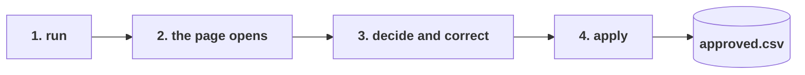

# A run from start to finish

What a user does and sees, on the eight documents supplied with the brief, offline. Every terminal block below is the real output of the commands shown.



## 1. Run

```
uv run docintel run data/provided --out output/demo --as-of 2026-08-20 --review
```

```
INFO docintel.graph: discovered 8 files under data\provided
thread:        run-20261008-162829
documents:     8
records:       37 (14 need review)
csv:           output\demo\records.csv
sqlite:        output\demo\review.sqlite
report:        output\demo\review_report.md
conflicts:     output\demo\conflicts.json
html:          output\demo\review.html

Review page: http://127.0.0.1:59018/review.html
Decide on the page and press Apply decisions. Ctrl+C here when you are done.
```

The input can be a folder or a single file. `--as-of` is the date validity is judged against; without it, today. The run stops at the review step, keeps its state in `checkpoints.sqlite` under the thread id it printed, and with `--review` serves the page on the loopback interface and opens it. Without `--review` it prints the two ways to continue: `docintel review --out output/demo` to serve the page later, or open `review.html` from disk and run `docintel approve` by hand (section 5).

## 2. The page opens

The first time, a short help panel explains the marks and the keys; after that it is behind the `?`.


One row per quotation line, least certain first. The note on each row is the one thing a person needs to know. Clean lines, 23 of the 37 here, carry no mark and no note.

## 3. Decide and correct

Open a row by clicking it or pressing `J`. The fields are on the left, the document on the right. For the glare photo that is the page itself; for the PDFs it is the rendered page with a Text view; for the JSON exports and the email it is the text with this line's evidence highlighted.


Click the page to zoom. Scroll wheel or `+` and `-` zoom around the cursor, drag pans, `Fit` and `100%` do what they say, arrows move between pages.


Decide with the buttons or `A`, `H`, `R`, then `J` for the next line. Pressing the same key again clears the decision. If you can read a value on the page that the pipeline could not, click the field and type it: it shows as "set by reviewer" with the original beside it, the red mark clears, and the line can be approved. Decisions and corrections stay in the browser, so closing the tab loses nothing.

In this session the reviewer rejected the five lines whose price or product could not be read on the photo, held one line whose price the supplier corrected in a postscript for a colleague to confirm, and approved the other thirty-one.


## 4. Apply

Press **Apply decisions**. The page sends the decisions and corrections to the local server, the run resumes from its checkpoint, and the result appears under the heading:

> **Applied.** 31 approved, 5 rejected, 1 held, 1 corrected. approved.csv holds the lines that go on; decide the held ones and apply again.

The terminal shows the same:

```
INFO docintel.graph: promote: 31 lines approved, 5 rejected, 1 held, 1 corrected
applied:   31 approved, 5 rejected, 1 held, 1 corrected -> output\demo\approved.csv
```

Corrections are applied first, so a line whose price the reviewer typed in from the zoomed page is approved with that price. A held line stays pending; decide it and press Apply again. Ctrl+C in the terminal when you are done.

## 5. Without the server

Open `review.html` from disk and the same button reads **Save decisions**: it saves `decisions.json` to your downloads and shows the command to run once the file is next to the page:

```
uv run docintel approve --thread-id run-20261008-162829 --out output/demo --decisions output/demo/decisions.json
```

```
approved:  31 lines -> output\demo\approved.csv
rejected:  5
corrected: 1 lines had values set by the reviewer
held:      1 (no decision yet; run approve again with more)
```

The file is small and readable. Each key is a record id, the document's content hash and the line number, so a decision follows the line even if the file is renamed:

```json
{
  "run": "2026-10-08T16:28:30+00:00",
  "thread_id": "run-20261008-162829",
  "decisions": { "687ef24b38889f7b:1": "approve", "687ef24b38889f7b:2": "reject", ... },
  "corrections": { "687ef24b38889f7b:1": { "price_per_uom": 0.0091 } }
}
```

## What is in the folder afterwards

| File | What it is for |
|---|---|
| `approved.csv` | The 31 lines a system of record should take. Same columns as `records.csv`. |
| `final.csv` | Every line with its final status: approved, rejected, or still pending (held or undecided), and any corrected values. Rejected lines are kept here and in the audit, never in `approved.csv`. |
| `records.csv` | All 37 lines with values, evidence quotes, per-field confidence and flags. The audit trail. |
| `review.html` | The page, with the decisions still in the browser that made them. |
| `review_report.md` | The same table as a report: what to look at first, then everything. |
| `conflicts.json` | Four products quoted by two suppliers each, and the Andina proforma that arrived as a PDF and two scans, cross-checked. |
| `review.sqlite` | Records, conflicts and duplicates as tables, for anyone who prefers SQL. |
| `decisions.json`, `decisions_applied.json` | What the reviewer sent, and what the pipeline did with it, corrections included. |
| `sources/` | Page previews the review page shows. |
| `checkpoints.sqlite`, `run.json` | The run's state, so it can be resumed, and the thread id `docintel review` uses to find it. |

## Live, with a model

The same commands with `--extractor model --model anthropic:claude-sonnet-5-5` and `ANTHROPIC_API_KEY` set. Everything else, the verification, the scoring, the page, is identical: the model only ever produces the extraction, and nothing it says about its own confidence is used.
