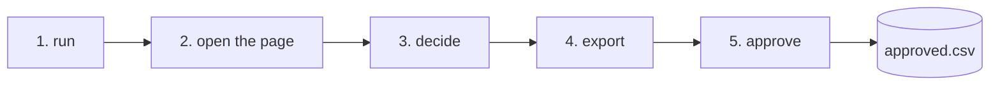
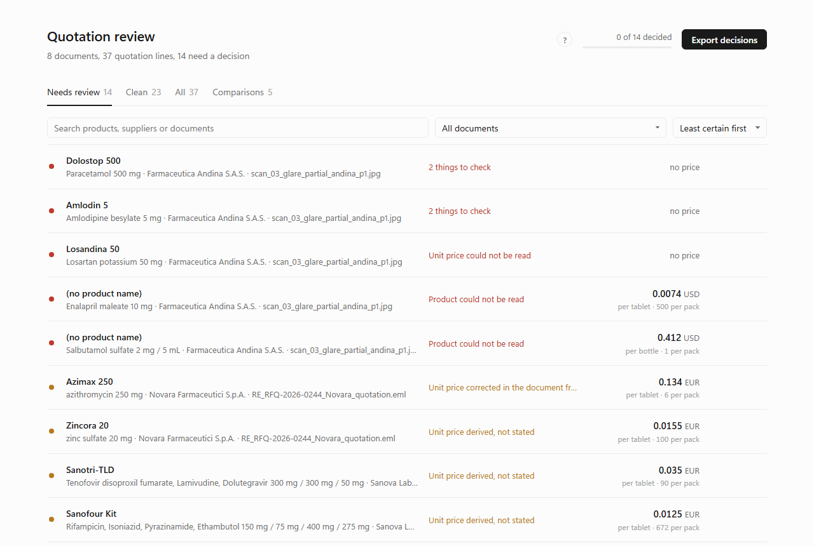
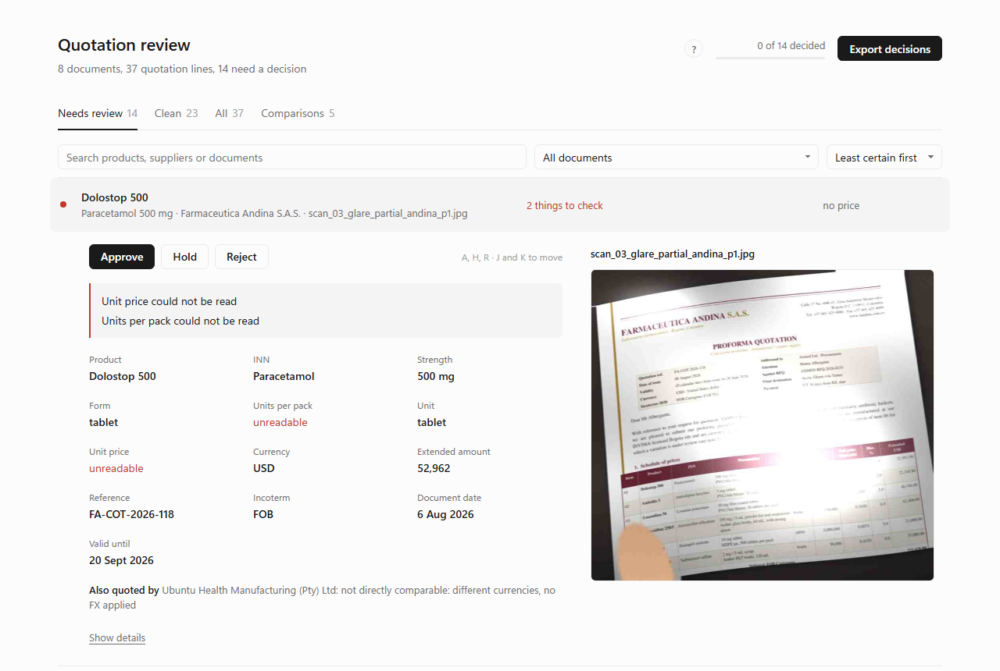
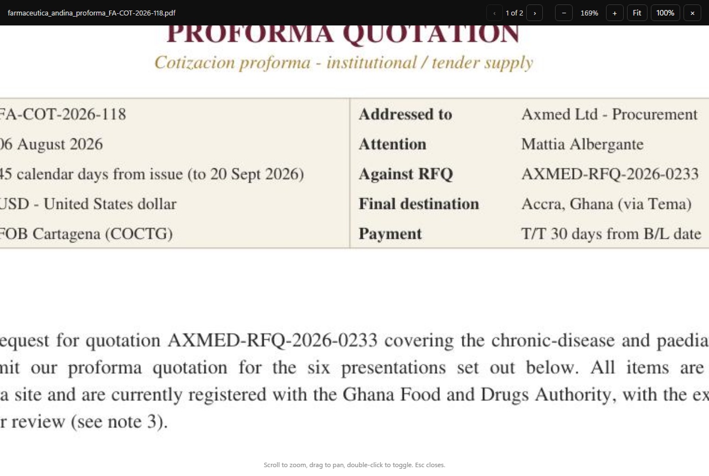
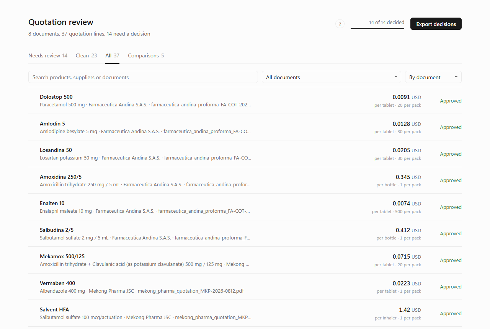

# A run from start to finish

What a user does and sees, on the eight documents supplied with the brief, offline. Every terminal block below is the real output of the commands shown.



## 1. Run

```
uv run docintel run data/provided --out output/demo --as-of 2026-08-20
```

```
INFO docintel.graph: discovered 8 files under data\provided
thread:        run-20261008-162829
documents:     8
records:       37 (14 need review)
csv:           output\demo\records.csv
sqlite:        output\demo\review.sqlite
report:        output\demo\review_report.md
conflicts:     output\demo\conflicts.json
html:          output\demo\review.html

Stopped for review. Open output\demo\review.html in a browser, decide, export the decisions, then:
  docintel approve --thread-id run-20261008-162829 --out output\demo --decisions output\demo\decisions.json
```

The input can be a folder or a single file. `--as-of` is the date validity is judged against; without it, today. The run stops at the review step and keeps its state in `checkpoints.sqlite` under the thread id it printed, so `approve` later picks up exactly where it stopped.

## 2. Open the page

`output/demo/review.html` opens from disk in any browser. The first time, a short help panel explains the marks and the keys; after that it is behind the `?`.



One row per quotation line, least certain first. The note on each row is the one thing a person needs to know. Clean lines, 23 of the 37 here, carry no mark and no note.

## 3. Decide

Open a row by clicking it or pressing `J`. The fields are on the left, the document on the right. For the glare photo that is the page itself; for the PDFs it is the rendered page with a Text view; for the JSON exports and the email it is the text with this line's evidence highlighted.



Click the page to zoom. Scroll wheel or `+` and `-` zoom around the cursor, drag pans, `Fit` and `100%` do what they say, arrows move between pages.



Decide with the buttons or `A`, `H`, `R`, then `J` for the next line. Pressing the same key again clears the decision. Decisions stay in the browser, so closing the tab loses nothing.

In this session the reviewer rejected the five lines whose price or product could not be read on the photo, held one line whose price the supplier corrected in a postscript for a colleague to confirm, and approved the other thirty-one.



## 4. Export

**Export decisions** copies the decisions as JSON. Save it as `output/demo/decisions.json`:

```json
{
  "run": "2026-10-08T16:28:30+00:00",
  "decisions": {
    "687ef24b38889f7b:1": "reject",
    "687ef24b38889f7b:2": "reject",
    "4f98a2993aad8978:1": "hold",
    "4f98a2993aad8978:2": "approve",
    "6dbf066a71947643:1": "approve",
    ...
  }
}
```

Each key is a record id: the document's content hash and the line number, so the decision follows the line even if the file is renamed.

## 5. Approve

```
uv run docintel approve --thread-id run-20261008-162829 --out output/demo --decisions output/demo/decisions.json
```

```
INFO docintel.graph: promote: 31 lines approved, 5 rejected, 1 held
approved:  31 lines -> output\demo\approved.csv
rejected:  5
held:      1 (no decision yet; run approve again with more)
```

The run resumes from its checkpoint, applies the decisions, writes `approved.csv` with the lines that go on, and records every decision in `decisions_applied.json`. A held line stays pending; a later `approve` with more decisions picks it up.

## What is in the folder afterwards

| File | What it is for |
|---|---|
| `approved.csv` | The 31 lines a system of record should take. Same columns as `records.csv`. |
| `records.csv` | All 37 lines with values, evidence quotes, per-field confidence and flags. The audit trail. |
| `review.html` | The page, with the decisions still in the browser that made them. |
| `review_report.md` | The same table as a report: what to look at first, then everything. |
| `conflicts.json` | Four products quoted by two suppliers each, and the Andina proforma that arrived as a PDF and two scans, cross-checked. |
| `review.sqlite` | Records, conflicts and duplicates as tables, for anyone who prefers SQL. |
| `decisions.json`, `decisions_applied.json` | What the reviewer exported, and what the pipeline did with it. |
| `sources/` | Page previews the review page shows. |
| `checkpoints.sqlite` | The run's state, so it can be resumed. |

## Live, with a model

The same commands with `--extractor model --model anthropic:claude-sonnet-5-5` and `ANTHROPIC_API_KEY` set. Everything else, the verification, the scoring, the page, is identical: the model only ever produces the extraction, and nothing it says about its own confidence is used.
